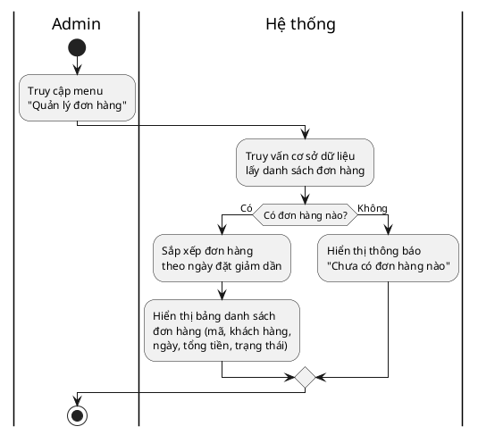
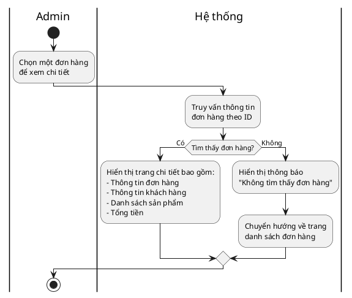
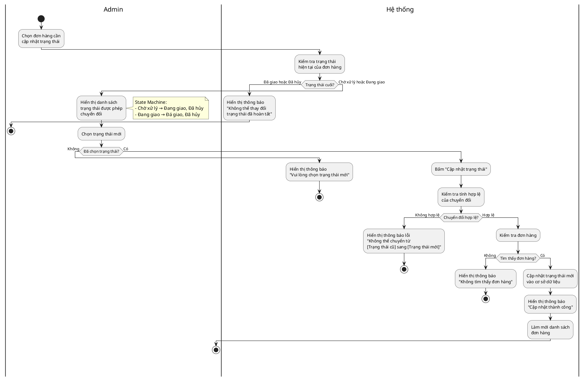
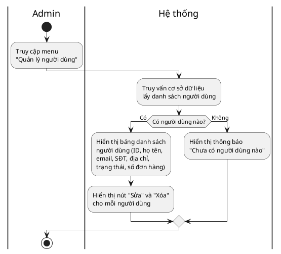
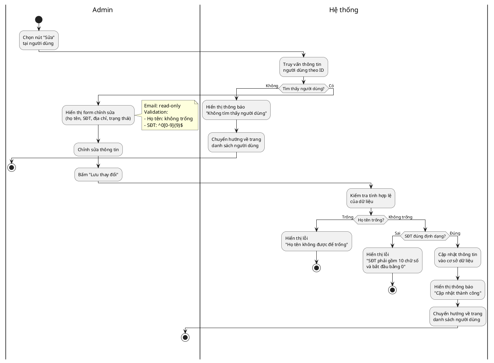
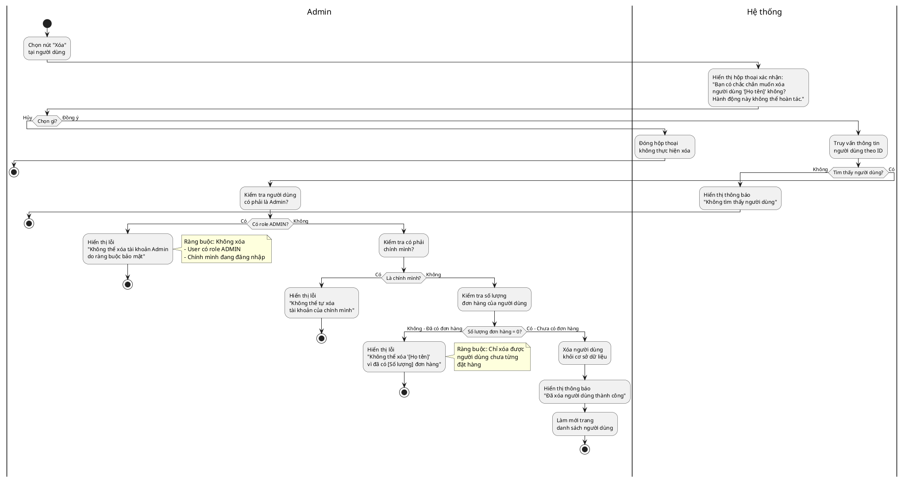

# Đặc tả phân hệ Quản lý Đơn hàng & Người dùng (Admin Dashboard)

## Mục lục
- [I. Quản lý Đơn hàng](#i-quản-lý-đơn-hàng)
  - [1. Xem danh sách đơn hàng](#1-xem-danh-sách-đơn-hàng)
  - [2. Xem chi tiết đơn hàng](#2-xem-chi-tiết-đơn-hàng)
  - [3. Cập nhật trạng thái đơn hàng](#3-cập-nhật-trạng-thái-đơn-hàng)
- [II. Quản lý Người dùng](#ii-quản-lý-người-dùng)
  - [4. Xem danh sách người dùng](#4-xem-danh-sách-người-dùng)
  - [5. Cập nhật thông tin người dùng](#5-cập-nhật-thông-tin-người-dùng)
  - [6. Xóa người dùng](#6-xóa-người-dùng)
- [III. Sơ đồ Activity (PlantUML)](#iii-sơ-đồ-activity-plantuml)
- [IV. Sơ đồ Sequence (PlantUML)](#iv-sơ-đồ-sequence-plantuml)
- [V. Phụ lục](#v-phụ-lục)

---

## I. QUẢN LÝ ĐƠN HÀNG

### 1. Xem danh sách đơn hàng

#### Use case: Xem danh sách đơn hàng

**Mục đích:** Giúp quản trị viên xem tất cả các đơn hàng trong hệ thống được sắp xếp theo ngày đặt hàng.

**Mô tả:** Quản trị viên truy cập vào trang quản lý đơn hàng để xem danh sách tất cả các đơn hàng (gồm mã đơn, tên khách hàng, ngày đặt, tổng tiền, trạng thái).

**Tác nhân:** Quản trị viên (Admin).

**Điều kiện trước:** Quản trị viên đã đăng nhập vào hệ thống với quyền ADMIN.

**Điều kiện sau:** Danh sách đơn hàng được hiển thị đầy đủ và sắp xếp theo thứ tự ngày đặt hàng giảm dần (mới nhất trước).

**Lưu ý:** Chức năng tìm kiếm, lọc theo trạng thái và phân trang nằm ngoài phạm vi đặc tả này (Out of scope).

#### Luồng sự kiện chính (Basic flows)

| Người dùng | Hệ thống |
|------------|----------|
| 1. Truy cập vào menu "Quản lý đơn hàng" trên admin dashboard. | |
| | 2. Hệ thống truy vấn cơ sở dữ liệu lấy danh sách tất cả đơn hàng. |
| | 3. Hệ thống sắp xếp danh sách đơn hàng theo ngày đặt giảm dần (mới nhất ở đầu). |
| | 4. Hiển thị bảng danh sách đơn hàng bao gồm: mã đơn hàng, tên khách hàng, email, số điện thoại, ngày đặt, địa chỉ giao hàng, tổng tiền, trạng thái đơn hàng. |

#### Luồng sự kiện phụ (Alternative Flows)

| Người dùng | Hệ thống |
|------------|----------|
| | 2.1 Hệ thống kiểm tra và ghi nhận chưa có đơn hàng nào trong hệ thống. |
| | 2.2 Hệ thống hiển thị thông báo "Chưa có đơn hàng nào". |

---

### 2. Xem chi tiết đơn hàng

#### Use case: Xem chi tiết đơn hàng

**Mục đích:** Giúp quản trị viên xem thông tin chi tiết của một đơn hàng cụ thể.

**Mô tả:** Quản trị viên chọn một đơn hàng từ danh sách để xem thông tin chi tiết bao gồm thông tin khách hàng, danh sách sản phẩm, số lượng, đơn giá, thành tiền và tổng giá trị đơn hàng.

**Tác nhân:** Quản trị viên (Admin).

**Điều kiện trước:** Quản trị viên đang ở trang danh sách đơn hàng và đã đăng nhập với quyền ADMIN.

**Điều kiện sau:** Trang chi tiết đơn hàng hiển thị đầy đủ thông tin về đơn hàng đã chọn.

#### Luồng sự kiện chính (Basic flows)

| Người dùng | Hệ thống |
|------------|----------|
| 1. Quản trị viên chọn một đơn hàng để xem chi tiết (bấm vào mã đơn hoặc nút "Xem chi tiết"). | |
| | 2. Hệ thống truy vấn thông tin đơn hàng theo ID đã chọn. |
| | 3. Hệ thống hiển thị trang chi tiết đơn hàng. |

**Thông tin được hiển thị bao gồm:**

- **Thông tin đơn hàng:** Mã đơn, ngày đặt, trạng thái
- **Thông tin khách hàng:** Họ tên, email, số điện thoại, địa chỉ giao hàng
- **Danh sách sản phẩm:** Tên sản phẩm, số lượng, đơn giá, thành tiền
- **Tổng cộng:** Tổng giá trị đơn hàng

#### Luồng sự kiện phụ (Alternative Flows)

| Người dùng | Hệ thống |
|------------|----------|
| | 2.1 Hệ thống không tìm thấy đơn hàng với ID đã chọn (đơn hàng đã bị xóa hoặc không tồn tại). |
| | 2.2 Hệ thống hiển thị thông báo "Không tìm thấy đơn hàng" và chuyển hướng về trang danh sách đơn hàng. |

---

### 3. Cập nhật trạng thái đơn hàng

#### Use case: Cập nhật trạng thái đơn hàng

**Mục đích:** Giúp quản trị viên thay đổi trạng thái của đơn hàng trong quá trình xử lý theo quy tắc chuyển đổi trạng thái hợp lệ.

**Mô tả:** Quản trị viên chọn trạng thái mới cho đơn hàng từ danh sách các trạng thái được phép chuyển đổi (dựa trên trạng thái hiện tại) và cập nhật vào hệ thống.

**Tác nhân:** Quản trị viên (Admin).

**Điều kiện trước:** Quản trị viên đang ở trang danh sách đơn hàng hoặc trang chi tiết đơn hàng và đã đăng nhập với quyền ADMIN.

**Điều kiện sau:** Trạng thái đơn hàng được cập nhật thành công trong cơ sở dữ liệu và hiển thị trạng thái mới trên giao diện.

**Quy tắc chuyển đổi trạng thái (State Machine):**

| Trạng thái hiện tại | Trạng thái được phép chuyển sang |
|---------------------|----------------------------------|
| **Chờ xử lý** | Đang giao, Đã hủy |
| **Đang giao** | Đã giao, Đã hủy |
| **Đã giao** | _(Không được phép thay đổi - Trạng thái cuối)_ |
| **Đã hủy** | _(Không được phép thay đổi - Trạng thái cuối)_ |

#### Luồng sự kiện chính (Basic flows)

| Người dùng | Hệ thống |
|------------|----------|
| 1. Quản trị viên chọn đơn hàng cần cập nhật trạng thái. | |
| | 2. Hệ thống kiểm tra trạng thái hiện tại của đơn hàng. |
| | 3. Hệ thống hiển thị danh sách các trạng thái được phép chuyển đổi dựa trên trạng thái hiện tại (theo State Machine). |
| 4. Quản trị viên chọn trạng thái mới từ danh sách. | |
| 5. Quản trị viên bấm nút "Cập nhật trạng thái". | |
| | 6. Hệ thống kiểm tra tính hợp lệ của chuyển đổi trạng thái. |
| | 7. Hệ thống cập nhật trạng thái mới vào cơ sở dữ liệu. |
| | 8. Hệ thống hiển thị thông báo "Cập nhật trạng thái đơn hàng #[Mã đơn] thành '[Trạng thái mới]' thành công!". |
| | 9. Hệ thống làm mới danh sách đơn hàng với trạng thái đã được cập nhật. |

#### Luồng sự kiện phụ (Alternative Flows)

| Người dùng | Hệ thống |
|------------|----------|
| | 2.1 Hệ thống không tìm thấy đơn hàng với ID được chọn. |
| | 2.2 Hệ thống hiển thị thông báo lỗi "Không tìm thấy đơn hàng" và không thực hiện cập nhật. |
| | 2.1.1 Hệ thống phát hiện đơn hàng đang ở trạng thái cuối ("Đã giao" hoặc "Đã hủy"). |
| | 2.1.2 Hệ thống hiển thị thông báo "Không thể thay đổi trạng thái đơn hàng đã hoàn tất". |
| 4.1 Quản trị viên không chọn trạng thái mới và bấm "Cập nhật trạng thái". | |
| | 4.2 Hệ thống hiển thị thông báo lỗi "Vui lòng chọn trạng thái mới". |
| 4.3 Quay lại bước 4. | |
| | 6.1 Hệ thống phát hiện chuyển đổi trạng thái không hợp lệ (vi phạm State Machine). |
| | 6.2 Hệ thống hiển thị thông báo lỗi "Không thể chuyển từ '[Trạng thái cũ]' sang '[Trạng thái mới]'". |
| 6.3 Quay lại bước 4. | |

---

## II. QUẢN LÝ NGƯỜI DÙNG

### 4. Xem danh sách người dùng

#### Use case: Xem danh sách người dùng

**Mục đích:** Giúp quản trị viên xem tất cả người dùng đã đăng ký trong hệ thống.

**Mô tả:** Quản trị viên truy cập vào trang quản lý người dùng để xem danh sách tất cả người dùng (gồm họ tên, email, số điện thoại, địa chỉ, trạng thái tài khoản, số lượng đơn hàng).

**Tác nhân:** Quản trị viên (Admin).

**Điều kiện trước:** Quản trị viên đã đăng nhập vào hệ thống với quyền ADMIN.

**Điều kiện sau:** Danh sách người dùng được hiển thị đầy đủ trên giao diện.

**Lưu ý:** Chức năng tìm kiếm theo tên/email và phân trang nằm ngoài phạm vi đặc tả này (Out of scope).

#### Luồng sự kiện chính (Basic flows)

| Người dùng | Hệ thống |
|------------|----------|
| 1. Truy cập vào menu "Quản lý người dùng" trên admin dashboard. | |
| | 2. Hệ thống truy vấn cơ sở dữ liệu lấy danh sách tất cả người dùng. |
| | 3. Hệ thống hiển thị bảng danh sách người dùng bao gồm: ID, họ tên, email, số điện thoại, địa chỉ, trạng thái (Hoạt động/Đã khóa), số lượng đơn hàng. |
| | 4. Hệ thống hiển thị các nút hành động: "Sửa" và "Xóa" cho mỗi người dùng. |

#### Luồng sự kiện phụ (Alternative Flows)

| Người dùng | Hệ thống |
|------------|----------|
| | 2.1 Hệ thống kiểm tra và ghi nhận chưa có người dùng nào trong hệ thống (ngoại trừ admin). |
| | 2.2 Hệ thống hiển thị thông báo "Chưa có người dùng nào". |

---

### 5. Cập nhật thông tin người dùng

#### Use case: Cập nhật thông tin người dùng

**Mục đích:** Giúp quản trị viên chỉnh sửa thông tin của người dùng trong hệ thống.

**Mô tả:** Quản trị viên chọn một người dùng từ danh sách, mở form chỉnh sửa và cập nhật thông tin như họ tên, số điện thoại, địa chỉ, trạng thái tài khoản.

**Tác nhân:** Quản trị viên (Admin).

**Điều kiện trước:** Quản trị viên đang ở trang danh sách người dùng và đã đăng nhập với quyền ADMIN.

**Điều kiện sau:** Thông tin người dùng được cập nhật thành công trong cơ sở dữ liệu và hiển thị trên giao diện.

**Quy tắc validation:**
- **Họ tên:** Không được để trống, tối đa 100 ký tự
- **Số điện thoại:** Đúng định dạng (10 chữ số, bắt đầu bằng 0), regex: `^0[0-9]{9}$`
- **Email:** Không cho phép chỉnh sửa (unique identifier)
- **Địa chỉ:** Tối đa 255 ký tự
- **Trạng thái:** 1 (Hoạt động) hoặc 0 (Đã khóa)

#### Luồng sự kiện chính (Basic flows)

| Người dùng | Hệ thống |
|------------|----------|
| 1. Quản trị viên chọn nút "Sửa" tại người dùng cần cập nhật. | |
| | 2. Hệ thống truy vấn thông tin người dùng theo ID đã chọn. |
| | 3. Hệ thống hiển thị form chỉnh sửa với các trường: họ tên, số điện thoại, địa chỉ, trạng thái (Hoạt động/Đã khóa). Email hiển thị dạng read-only. |
| 4. Quản trị viên chỉnh sửa thông tin cần thiết. | |
| 5. Quản trị viên bấm nút "Lưu thay đổi". | |
| | 6. Hệ thống kiểm tra tính hợp lệ của dữ liệu theo quy tắc validation. |
| | 7. Hệ thống cập nhật thông tin người dùng vào cơ sở dữ liệu. |
| | 8. Hệ thống hiển thị thông báo "Cập nhật thông tin người dùng '[Họ tên]' thành công!". |
| | 9. Hệ thống chuyển hướng về trang danh sách người dùng với dữ liệu đã được cập nhật. |

#### Luồng sự kiện phụ (Alternative Flows)

| Người dùng | Hệ thống |
|------------|----------|
| | 2.1 Hệ thống không tìm thấy người dùng với ID được chọn. |
| | 2.2 Hệ thống hiển thị thông báo "Không tìm thấy người dùng" và chuyển hướng về trang danh sách. |
| 4.1 Quản trị viên để trống trường họ tên. | |
| | 6.1 Hệ thống kiểm tra và phát hiện họ tên trống. |
| | 6.2 Hệ thống hiển thị thông báo lỗi "Họ tên không được để trống". |
| 6.3 Quay lại bước 4. | |
| 4.2 Quản trị viên nhập số điện thoại sai định dạng. | |
| | 6.4 Hệ thống kiểm tra và phát hiện số điện thoại không khớp regex ^0[0-9]{9}$. |
| | 6.5 Hệ thống hiển thị thông báo lỗi "Số điện thoại phải gồm 10 chữ số và bắt đầu bằng 0". |
| 6.6 Quay lại bước 4. | |

---

### 6. Xóa người dùng

#### Use case: Xóa người dùng

**Mục đích:** Giúp quản trị viên xóa người dùng khỏi hệ thống khi cần thiết.

**Mô tả:** Quản trị viên chọn xóa một người dùng từ danh sách. Hệ thống yêu cầu xác nhận, sau đó kiểm tra ràng buộc: chỉ cho phép xóa nếu người dùng chưa từng đặt hàng và không phải là tài khoản Admin. Nếu không thỏa mãn điều kiện, hệ thống từ chối xóa và thông báo lý do.

**Tác nhân:** Quản trị viên (Admin).

**Điều kiện trước:** Quản trị viên đang ở trang danh sách người dùng và đã đăng nhập với quyền ADMIN.

**Điều kiện sau:** 
- Nếu người dùng thỏa mãn điều kiện xóa: người dùng bị xóa khỏi hệ thống.
- Nếu không thỏa mãn: hệ thống từ chối xóa và hiển thị thông báo lỗi cụ thể.

**Ràng buộc bảo mật:**
- Không được xóa người dùng có role ADMIN
- Không được xóa chính tài khoản Admin đang đăng nhập
- Chỉ được xóa người dùng chưa từng có đơn hàng (số lượng đơn hàng = 0)

#### Luồng sự kiện chính (Basic flows)

| Người dùng | Hệ thống |
|------------|----------|
| 1. Quản trị viên chọn nút "Xóa" tại người dùng cần xóa. | |
| | 2. Hệ thống hiển thị hộp thoại xác nhận: "Bạn có chắc chắn muốn xóa người dùng '[Họ tên]' không? Hành động này không thể hoàn tác." |
| 3. Quản trị viên chọn "Đồng ý". | |
| | 4. Hệ thống truy vấn thông tin người dùng theo ID đã chọn. |
| | 5. Hệ thống kiểm tra người dùng không phải là Admin và không phải chính mình. |
| | 6. Hệ thống kiểm tra số lượng đơn hàng của người dùng trong cơ sở dữ liệu. |
| | 7. Hệ thống xác nhận người dùng chưa có đơn hàng nào (số lượng đơn hàng = 0). |
| | 8. Hệ thống xóa người dùng khỏi cơ sở dữ liệu. |
| | 9. Hệ thống hiển thị thông báo "Đã xóa người dùng '[Họ tên]' thành công!". |
| | 10. Hệ thống làm mới trang danh sách người dùng. |

#### Luồng sự kiện phụ (Alternative Flows)

| Người dùng | Hệ thống |
|------------|----------|
| 3.1 Quản trị viên chọn "Hủy" trong hộp thoại xác nhận. | |
| | 3.2 Hệ thống đóng hộp thoại và không thực hiện xóa. |
| | 4.1 Hệ thống không tìm thấy người dùng với ID được chọn. |
| | 4.2 Hệ thống hiển thị thông báo "Không tìm thấy người dùng" và không thực hiện xóa. |
| | 5.1 Hệ thống phát hiện người dùng có role ADMIN. |
| | 5.2 Hệ thống hiển thị thông báo lỗi "Không thể xóa tài khoản Admin '[Họ tên]' do ràng buộc bảo mật". |
| | 5.3 Hệ thống không thực hiện xóa và quay lại trang danh sách người dùng. |
| | 5.1.1 Hệ thống phát hiện người dùng cần xóa là chính Admin đang đăng nhập. |
| | 5.1.2 Hệ thống hiển thị thông báo lỗi "Không thể tự xóa tài khoản của chính mình". |
| | 5.1.3 Hệ thống không thực hiện xóa và quay lại trang danh sách người dùng. |
| | 7.1 Hệ thống kiểm tra và phát hiện người dùng đã có ít nhất 1 đơn hàng. |
| | 7.2 Hệ thống hiển thị thông báo lỗi "Không thể xóa '[Họ tên]' vì đã có [Số lượng] đơn hàng!". |
| | 7.3 Hệ thống không thực hiện xóa và quay lại trang danh sách người dùng. |

---

## III. SƠ ĐỒ ACTIVITY (PlantUML)

### 1. Activity Diagram - Xem danh sách đơn hàng



---

### 2. Activity Diagram - Xem chi tiết đơn hàng



---

### 3. Activity Diagram - Cập nhật trạng thái đơn hàng



---

### 4. Activity Diagram - Xem danh sách người dùng



---

### 5. Activity Diagram - Cập nhật thông tin người dùng



---

### 6. Activity Diagram - Xóa người dùng



---

## IV. SƠ ĐỒ SEQUENCE (PlantUML)

> **Lưu ý:** Các sơ đồ Sequence chi tiết được lưu trong file riêng: `Sequence-Diagrams-Updated.md`
>
> File đó bao gồm:
> - 6 Sequence Diagrams đầy đủ
> - Có tầng Service
> - Participants dạng hình tròn (entity)
> - SQL queries chi tiết
> - Đánh số bước rõ ràng

Xem file: [Sequence-Diagrams-Updated.md](./Sequence-Diagrams-Updated.md)

---

## V. PHỤ LỤC

### A. Danh sách trạng thái đơn hàng

| Trạng thái | Mô tả | Trạng thái có thể chuyển sang |
|------------|-------|-------------------------------|
| **Chờ xử lý** | Đơn hàng mới được tạo, chưa được xử lý | Đang giao, Đã hủy |
| **Đang giao** | Đơn hàng đã được xác nhận và đang trong quá trình giao hàng | Đã giao, Đã hủy |
| **Đã giao** | Đơn hàng đã được giao thành công đến khách hàng (trạng thái cuối) | _(Không thể thay đổi)_ |
| **Đã hủy** | Đơn hàng đã bị hủy bởi admin hoặc khách hàng (trạng thái cuối) | _(Không thể thay đổi)_ |

**State Machine Diagram:**

```
[Chờ xử lý] ──→ [Đang giao] ──→ [Đã giao]
      │              │
      └──→ [Đã hủy] ←┘
```

### B. Trạng thái tài khoản người dùng

| Trạng thái | Giá trị | Mô tả |
|------------|---------|-------|
| **Hoạt động** | 1 | Tài khoản đang hoạt động bình thường |
| **Đã khóa** | 0 | Tài khoản đã bị khóa, không thể đăng nhập |

### C. Ràng buộc dữ liệu (Data Constraints)

#### 1. Đơn hàng (Order)

| Trường | Kiểu dữ liệu | Ràng buộc |
|--------|-------------|-----------|
| `id` | BIGINT | Khóa chính, tự động tăng |
| `orderDate` | DATETIME | Không được null |
| `totalAmount` | DOUBLE | Không được null, >= 0 |
| `status` | VARCHAR(50) | Không được null, giá trị: "Chờ xử lý", "Đang giao", "Đã giao", "Đã hủy" |
| `shippingAddress` | VARCHAR(255) | Tối đa 255 ký tự |
| `phone` | VARCHAR(20) | Tối đa 20 ký tự, định dạng: ^0[0-9]{9}$ |
| `user_id` | BIGINT | Khóa ngoại tham chiếu `users(id)`, có thể null (khách vãng lai) |

#### 2. Chi tiết đơn hàng (OrderDetail)

| Trường | Kiểu dữ liệu | Ràng buộc |
|--------|-------------|-----------|
| `id` | BIGINT | Khóa chính, tự động tăng |
| `order_id` | BIGINT | Khóa ngoại tham chiếu `orders(id)`, không được null, ON DELETE CASCADE |
| `product_id` | BIGINT | Khóa ngoại tham chiếu `products(id)`, không được null |
| `quantity` | INT | Không được null, > 0 |
| `price` | DOUBLE | Không được null, > 0 (snapshot giá tại thời điểm đặt hàng) |

**Lưu ý:** `price` trong `OrderDetail` là snapshot giá tại thời điểm đặt hàng, không thay đổi khi giá sản phẩm trong bảng `products` thay đổi.

#### 3. Người dùng (User)

| Trường | Kiểu dữ liệu | Ràng buộc |
|--------|-------------|-----------|
| `id` | BIGINT | Khóa chính, tự động tăng |
| `fullName` | VARCHAR(100) | Không được null, không trống, tối đa 100 ký tự |
| `email` | VARCHAR(100) | Không được null, UNIQUE, tối đa 100 ký tự, định dạng email hợp lệ |
| `phone` | VARCHAR(20) | Tối đa 20 ký tự, định dạng: ^0[0-9]{9}$ (10 chữ số, bắt đầu bằng 0) |
| `password` | VARCHAR(255) | Không được null (mật khẩu đã mã hóa BCrypt) |
| `address` | VARCHAR(255) | Tối đa 255 ký tự |
| `status` | INT | Không được null, giá trị: 1 (Hoạt động) hoặc 0 (Đã khóa), mặc định: 1 |

#### 4. Vai trò (Role)

| Trường | Kiểu dữ liệu | Ràng buộc |
|--------|-------------|-----------|
| `id` | BIGINT | Khóa chính, tự động tăng |
| `name` | VARCHAR(50) | Không được null, UNIQUE, giá trị: "ADMIN", "USER" |

#### 5. Bảng liên kết User-Role (user_roles)

| Trường | Kiểu dữ liệu | Ràng buộc |
|--------|-------------|-----------|
| `user_id` | BIGINT | Khóa ngoại tham chiếu `users(id)`, ON DELETE CASCADE |
| `role_id` | BIGINT | Khóa ngoại tham chiếu `roles(id)`, ON DELETE CASCADE |
| Khóa chính | | Composite key (user_id, role_id) |

### D. Quy tắc Validation

#### 1. Validation cho số điện thoại

- **Regex:** `^0[0-9]{9}$`
- **Mô tả:** Phải gồm đúng 10 chữ số, bắt đầu bằng số 0
- **Ví dụ hợp lệ:** 0901234567, 0987654321
- **Ví dụ không hợp lệ:** 123456789 (không bắt đầu bằng 0), 09012345678 (11 chữ số), 090123456 (9 chữ số)

#### 2. Validation cho họ tên

- **Quy tắc:** Không được để trống, tối đa 100 ký tự
- **Ví dụ hợp lệ:** Nguyễn Văn An, Trần Thị Bình
- **Ví dụ không hợp lệ:** "" (trống), "   " (chỉ có khoảng trắng)

#### 3. Validation cho email

- **Quy tắc:** Phải đúng định dạng email chuẩn
- **Regex:** `^[A-Za-z0-9+_.-]+@[A-Za-z0-9.-]+\.[A-Za-z]{2,}$`
- **Ví dụ hợp lệ:** user@example.com, admin@company.vn
- **Ví dụ không hợp lệ:** user@, @example.com, user.example.com

### E. Ràng buộc Bảo mật (Security Constraints)

#### 1. Ràng buộc xóa người dùng

| Điều kiện | Cho phép xóa? | Thông báo lỗi |
|-----------|---------------|---------------|
| Người dùng có role ADMIN | ❌ Không | "Không thể xóa tài khoản Admin '[Họ tên]' do ràng buộc bảo mật" |
| Admin đang đăng nhập tự xóa chính mình | ❌ Không | "Không thể tự xóa tài khoản của chính mình" |
| Người dùng đã có đơn hàng (orderCount > 0) | ❌ Không | "Không thể xóa '[Họ tên]' vì đã có [Số lượng] đơn hàng!" |
| Người dùng thường, chưa có đơn hàng | ✅ Có | "Đã xóa người dùng '[Họ tên]' thành công!" |

#### 2. Phân quyền truy cập

- Tất cả các chức năng quản lý đều yêu cầu người dùng phải đăng nhập với quyền **ADMIN**
- Admin và User dùng chung hệ thống đăng nhập, phân quyền thông qua bảng `roles` và `user_roles`
- URL pattern `/admin/*` chỉ cho phép truy cập với role ADMIN (cấu hình trong Spring Security)

### F. Lưu ý triển khai (Implementation Notes)

#### 1. Chức năng nằm ngoài phạm vi (Out of Scope)

Các chức năng sau **KHÔNG** được đặc tả trong tài liệu này và nằm ngoài phạm vi triển khai hiện tại:

- Tìm kiếm đơn hàng theo tên khách hàng, email, số điện thoại
- Lọc đơn hàng theo trạng thái, khoảng ngày
- Phân trang danh sách đơn hàng và người dùng
- Tìm kiếm người dùng theo tên hoặc email
- Export danh sách đơn hàng/người dùng ra Excel/PDF
- Gửi email thông báo khi thay đổi trạng thái đơn hàng
- Lịch sử thay đổi trạng thái đơn hàng

#### 2. Xử lý Confirm Dialog

- Hộp thoại xác nhận trước khi xóa người dùng nên được triển khai ở **frontend** (JavaScript/JSP)
- Backend chỉ cần xử lý logic kiểm tra ràng buộc sau khi nhận request xóa
- Nội dung confirm: "Bạn có chắc chắn muốn xóa người dùng '[Họ tên]' không? Hành động này không thể hoàn tác."

#### 3. State Machine cho trạng thái đơn hàng

Nên tạo một service hoặc validator riêng để kiểm tra tính hợp lệ của chuyển đổi trạng thái:

```java
public class OrderStatusValidator {
    public boolean isValidTransition(String currentStatus, String newStatus) {
        // Implementation based on State Machine rules
    }
}
```

#### 4. Snapshot giá sản phẩm

- Khi tạo đơn hàng, giá sản phẩm phải được **snapshot** vào bảng `order_details`
- Điều này đảm bảo tổng tiền đơn hàng không thay đổi khi giá sản phẩm trong catalog thay đổi

---

**Ngày tạo:** 2026-09-27  
**Phiên bản:** 2.0  
**Người soạn:** AI Assistant  
**Trạng thái:** Hoàn chỉnh với Activity Diagrams (swimlanes) và link đến Sequence Diagrams
