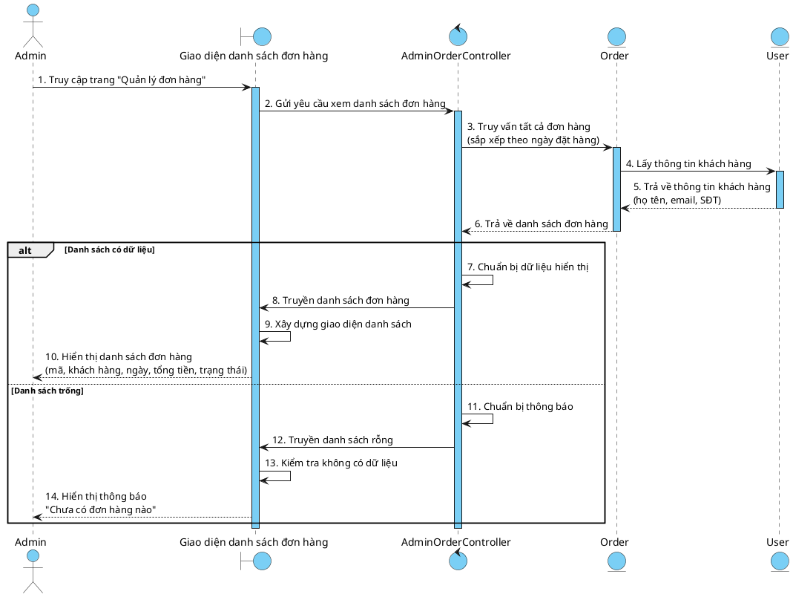
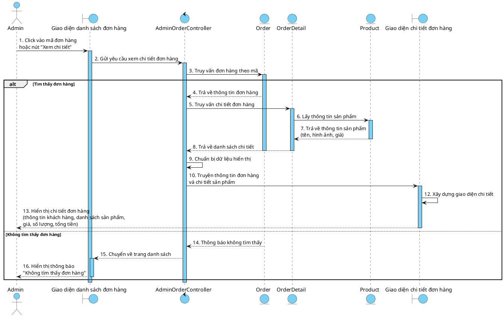
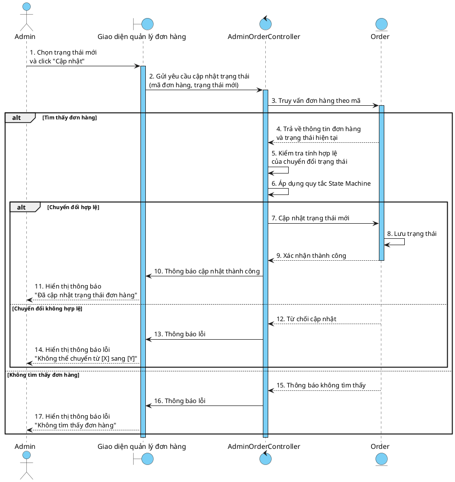
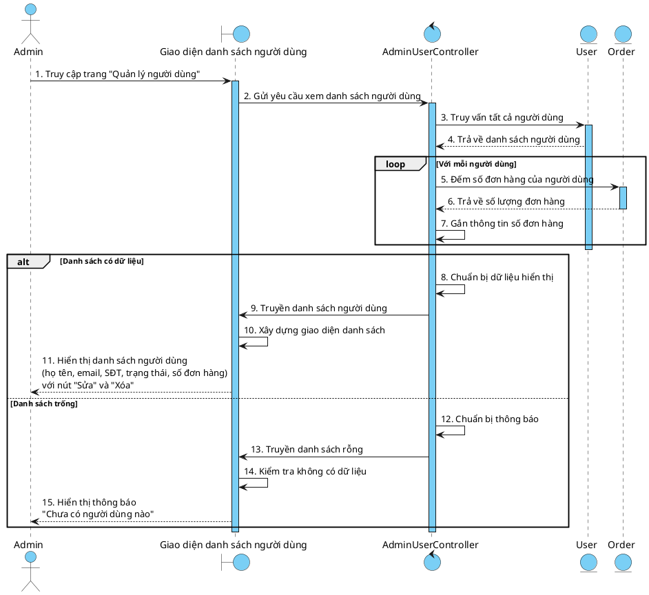
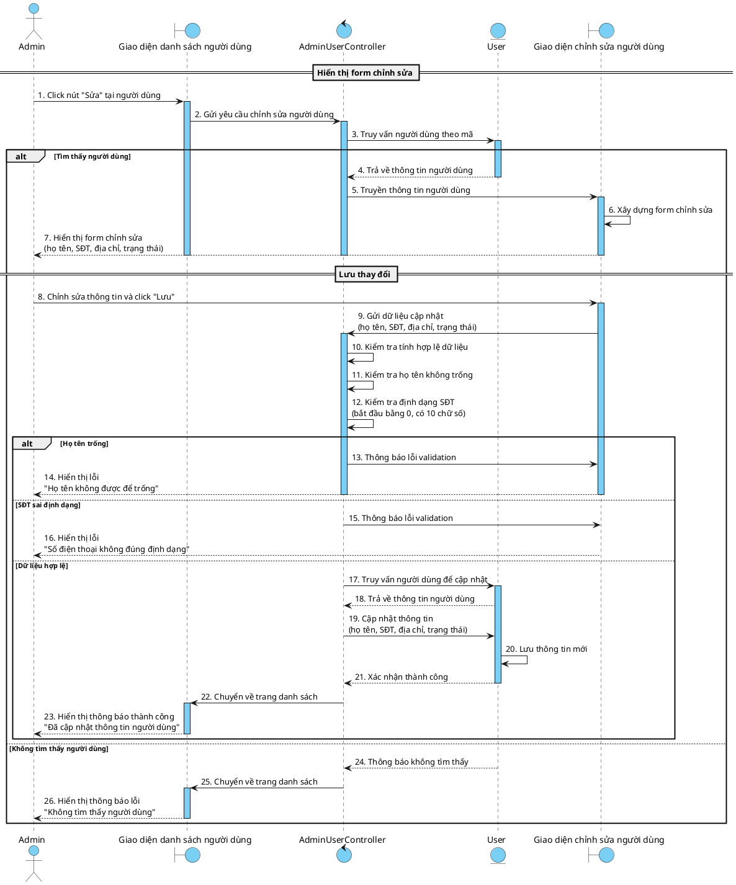
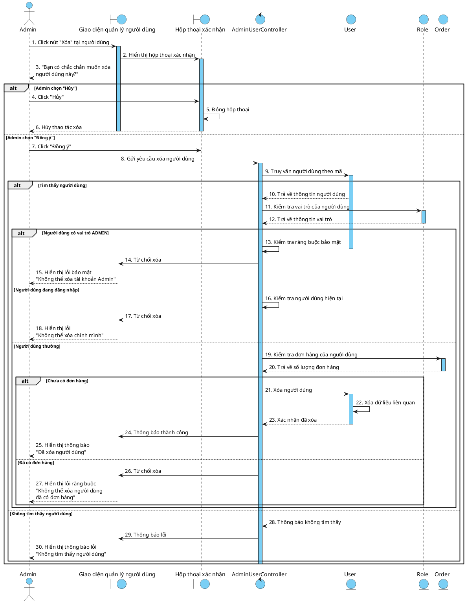

# SƠ ĐỒ SEQUENCE (PlantUML) - PHIÊN BẢN CUỐI CÙNG

> **Cấu trúc:**
> - `actor` - Admin (hình người)
> - `boundary` - View JSP (hình tròn với đường nét)
> - `control` - Controller (hình tròn với mũi tên)
> - `entity` - Các entity nghiệp vụ: Order, User, OrderDetail, Product (hình tròn)

---

## 1. Sequence Diagram - Xem danh sách đơn hàng

---

## 2. Sequence Diagram - Xem chi tiết đơn hàng

---

## 3. Sequence Diagram - Cập nhật trạng thái đơn hàng

---

## 4. Sequence Diagram - Xem danh sách người dùng

---

## 5. Sequence Diagram - Cập nhật thông tin người dùng

---

## 6. Sequence Diagram - Xóa người dùng

---

## Hướng dẫn sử dụng

### Hình dạng participants:
- `actor` - Hình người (Admin)
- `boundary` - Hình tròn với đường nét (Giao diện người dùng, Hộp thoại)
- `control` - Hình tròn với mũi tên (Controller xử lý nghiệp vụ)
- `entity` - Hình tròn (Order, User, OrderDetail, Product, Role)

### Màu sắc:
- Background màu #7ACFF5 cho tất cả participants (View, Controller, Entity)
- LifeLineBackgroundColor #7ACFF5
- ActorBackgroundColor #7ACFF5

### Cấu trúc đơn giản:
- Chỉ 4 loại: actor, boundary, control, entity
- Entity là các đối tượng nghiệp vụ cụ thể
- Boundary là các giao diện người dùng
- Control là các thành phần xử lý logic
- Không có stereotype (<<View>>, <<Controller>>, <<Entity>>)
- Không có tầng Service, Repository, Database riêng
- Không có chi tiết kỹ thuật implementation (JSP, SQL, etc.)

**Test tại:** https://www.plantuml.com/plantuml/uml/
