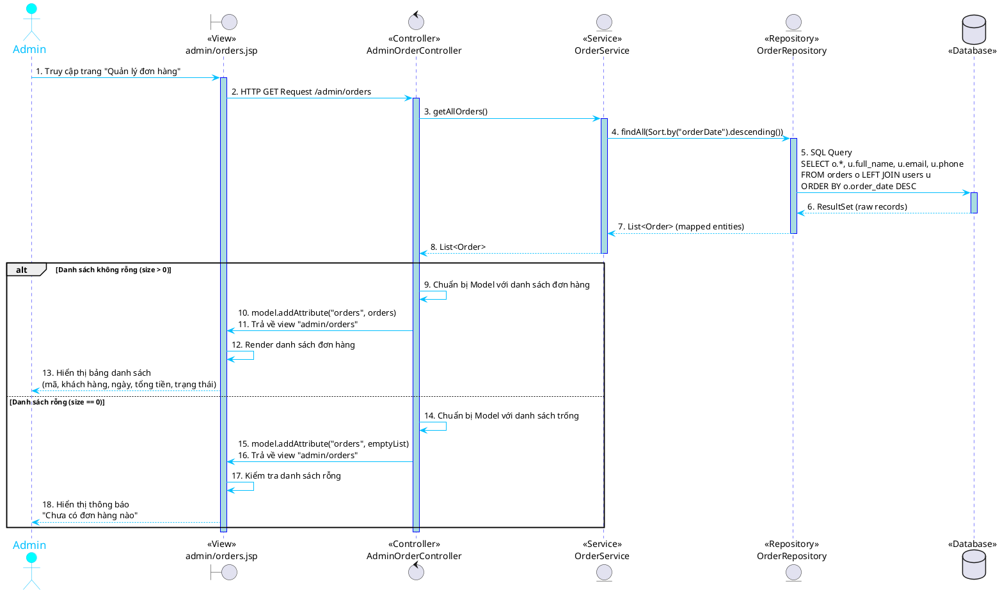
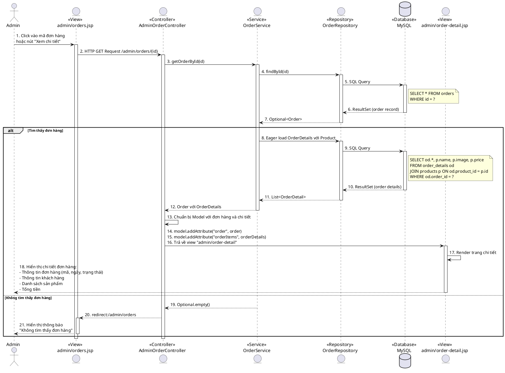
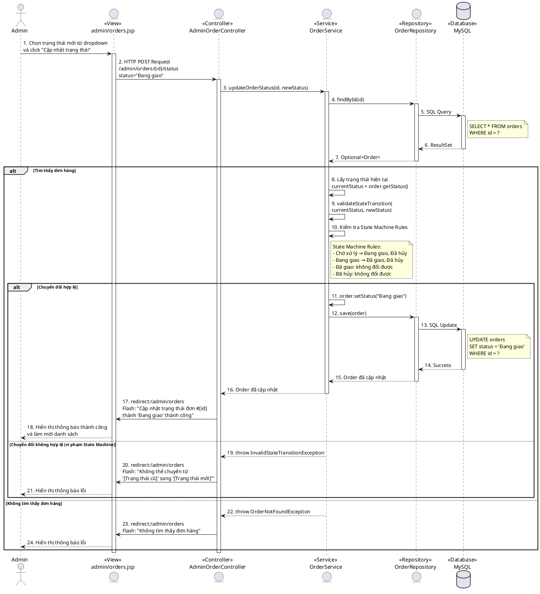
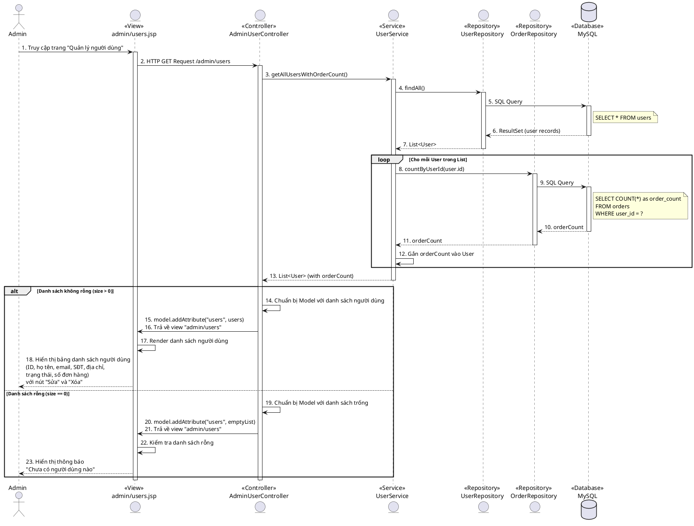
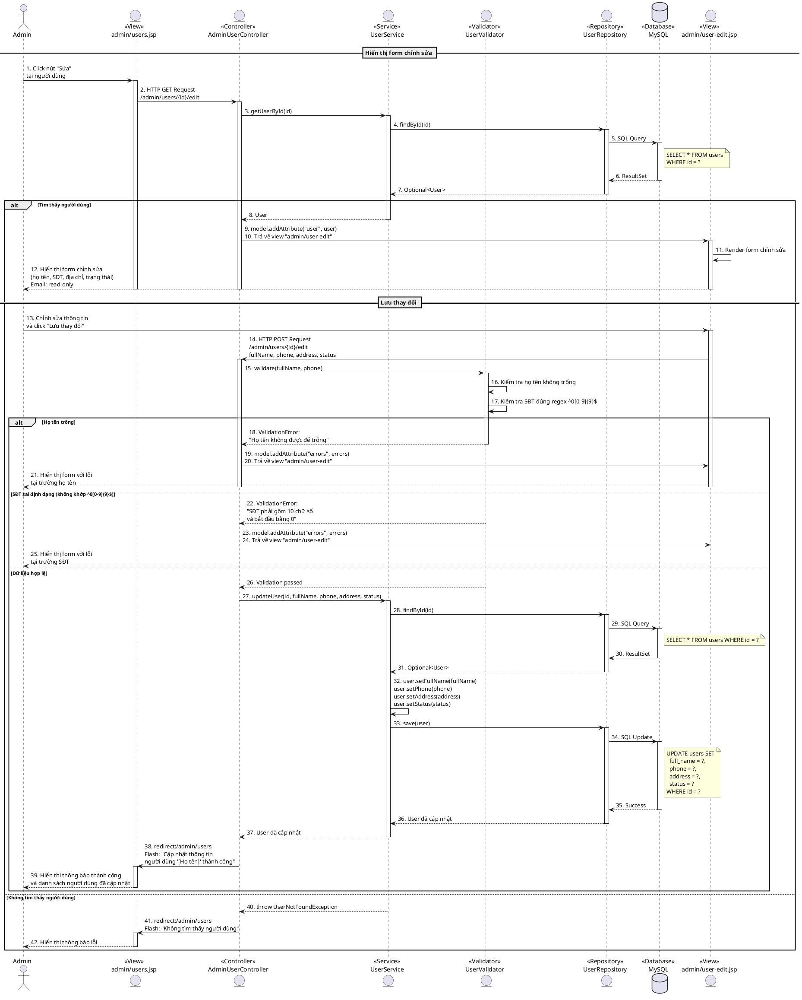
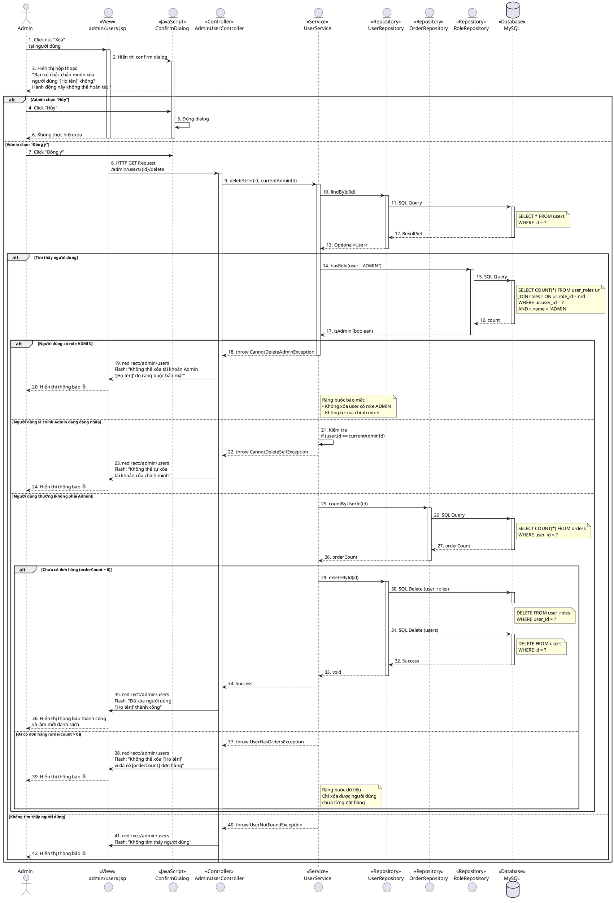

# SƠ ĐỒ SEQUENCE (PlantUML) - CẬP NHẬT

> **Lưu ý:** Tất cả sơ đồ đã được cập nhật với:
> - ✅ Thêm tầng Service đầy đủ
> - ✅ Sử dụng `entity` để có hình tròn cho participants
> - ✅ Đánh số bước rõ ràng
> - ✅ SQL queries chi tiết

---

## 1. Sequence Diagram - Xem danh sách đơn hàng

---

## 2. Sequence Diagram - Xem chi tiết đơn hàng

---

## 3. Sequence Diagram - Cập nhật trạng thái đơn hàng

---

## 4. Sequence Diagram - Xem danh sách người dùng

---

## 5. Sequence Diagram - Cập nhật thông tin người dùng

---

## 6. Sequence Diagram - Xóa người dùng

---

## Hướng dẫn sử dụng

1. Copy từng đoạn code PlantUML vào file `.md` gốc của bạn
2. Hoặc test trực tiếp tại: https://www.plantuml.com/plantuml/uml/
3. Các sơ đồ sẽ hiển thị với:
   - **Hình tròn** cho tất cả participants (nhờ dùng `entity`)
   - **Tầng Service** đầy đủ trong mọi luồng xử lý
   - **SQL queries** chi tiết trong notes
   - **Đánh số bước** rõ ràng

## Lưu ý kỹ thuật

- `skinparam participantPadding 20` - Tăng khoảng cách giữa các participants
- `skinparam boxPadding 10` - Tăng padding cho các box
- `entity` thay vì `participant` - Tạo hình tròn
- `actor` - Giữ nguyên cho Admin (hình người)
- `database` - Giữ nguyên cho MySQL (hình cylinder)
